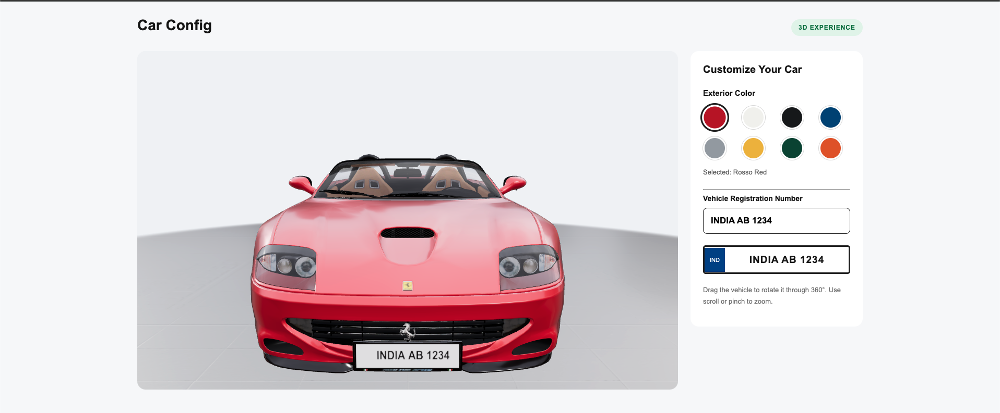

# 🚗 3D Car Viewer

An interactive 3D Car Viewer built using **React, Vite, and Three.js**. Users can explore a car in 360 degrees, customize its exterior paint color, and dynamically change the vehicle registration number.

The application uses a GLB 3D model to provide a realistic car-viewing experience with interactive camera controls and real-time customization.

## 📸 Landing Page Preview



## ✨ Features

1.  Interactive 360° Car Viewer
2.  Dynamic Number Plate
3.  Dynamic Car Color
4.  3D Rendering

## 🛠 Technology Stack

| Technology        | Purpose                           |
| ----------------- | --------------------------------- |
| React             | Frontend UI                       |
| Vite              | Development server and build tool |
| Three.js          | 3D rendering engine               |
| React Three Fiber | React integration for Three.js    |
| @react-three/drei | 3D helpers and controls           |
| GLTF / GLB        | 3D car model format               |
| CanvasTexture     | Dynamic number plate rendering    |
| CSS3              | Responsive interface and styling  |

## 🚘 Model Configuration

Place your car model inside:

```text
public/models/cars.glb
```

The application loads the model using React Three Fiber and Drei's `useGLTF` hook.

```jsx
const { scene } = useGLTF("/models/cars.glb");
```

### Number Plate Configuration

The current car model contains two original number plate meshes:

- `Object_51` – Front number plate.
- `Object_52` – Rear number plate.

These are hidden and replaced with dynamically generated 3D number plates.

### Dynamic Number Plate

The registration number is controlled through React state.

```jsx
const [plate, setPlate] = useState("INDIA AB 1234");
```

### Car Color Customization

The application updates the car's body materials dynamically without reloading the model.

```jsx
<CarModel plate={plate} carColor={carColor} />
```

## 🚀 Future Enhancements

- Metallic, matte, pearl, and gloss paint finishes.
- Custom HEX color picker.
- Multiple car models.
- Different wheel and alloy options.
- Interior 3D visualization.
- Open and close doors.
- Headlight and taillight controls.
- Download customized car screenshots.

## 📄 License

This project is developed for learning, experimentation, and personal use.

You are welcome to explore, modify, and use the source code for your own projects. However, please respect the licenses and usage terms of any third-party libraries, tools, 3D models, and assets used in this project.

**Note:** The 3D car models (`.glb` files) and other public assets may belong to their respective owners and may have separate licensing terms. Please verify their licenses before using them in commercial projects or redistributing them.

If you have any questions regarding this project, feel free to contact me.

## 🤝 Contributions

Contributions and improvements are welcome. You can suggest new features, report bugs, or help enhance the 3D car customization experience.

---

**Developed with React + Three.js**
_Interactive 3D Car Experience | Dynamic Number Plate | Real-Time Color Customization_
